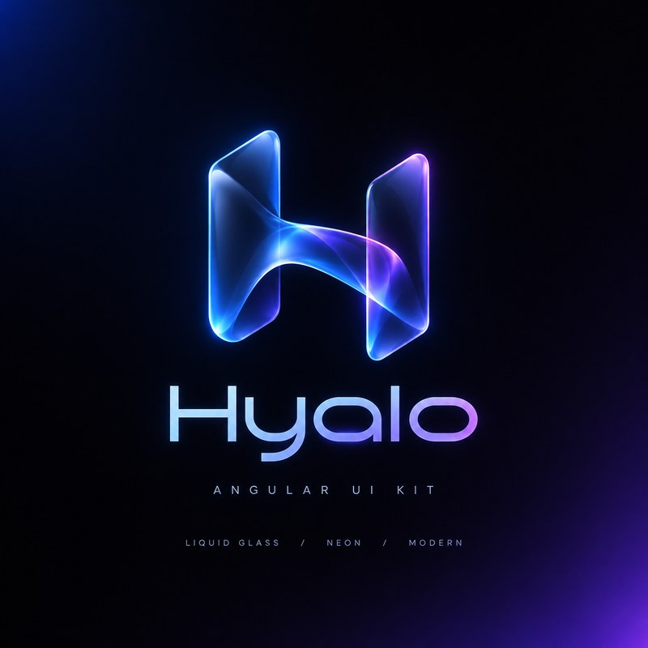

<p align="center">
  
</p>

# Hyalo

Liquid glass components for Angular.

Hyalo is an open source UI kit built on Angular Aria and the Angular CDK. It uses signals, supports zoneless and server rendering, and includes keyboard navigation, accessible names, and right-to-left layouts. Glass is a material you choose per surface, and it adapts to device capabilities and display preferences.

The repository is prepared for version 0.6.0. The API can still change before 1.0. See the [changelog](projects/hyalo/CHANGELOG.md), [verification guide](docs/verification.md), and [API audit](docs/api-audit-remaining.md).

Phase 6 covers all 11 heavy-data families: data grid, tree, tree table, virtual scroller, Kanban, calendar/scheduler, splitter, dashboard layout, context menu, rich text editor, and the existing gauge. Every family has a live docs route and a generated public API inventory. FullCalendar and TipTap are optional lazy engines. See [phase 6](docs/phase-6.md), [API comparison](docs/phase-6-api-review.md), and [complete API reference](docs/phase-6-api.md).

Phase 5 added 12 reusable mobile and app families and three editable compositions. They cover sheets, app navigation, floating actions, keypad, gestures, card stacks, notifications, chat, meters, dock, and status island. Open `/mobile-patterns` for wallet, transfer, and order-tracker examples. See [phase 5](docs/phase-5.md) for API comparisons and integration details.

Phase 4 adds all 14 advanced form families, Gregorian/Jalali dates and ranges, localized amounts, searchable selection, OTP, masks, sliders, uploads, rating, card choices, and inline editing. Open `/advanced-forms` for booking, sign-in, and settings compositions. The dashboard now supports autocomplete, multiple statuses, and arbitrary UTC date ranges. See [phase 4](docs/phase-4.md) for APIs and verification.

Phase 3 adds the app shell and data collection: collapsible sidebar, breadcrumb, dropdown and split menus, command palette, mega navigation, pagination, sortable/selectable table, KPI tile, lazy Chart.js wrapper, sparkline, progress, spinner, alerts, empty states, lists, and layout helpers. Run the docs and open `/dashboard` for the composed workspace demo.

## Install

```sh
npm install @hyalo/angular
```

Requires Angular 22.2 or later. GSAP is optional (see [Motion](#motion)).

Add the stylesheet before your own styles in `angular.json`:

```json
"styles": ["node_modules/@hyalo/angular/styles/hyalo.css", "src/styles.css"]
```

All of it sits in cascade layers (`hy.reset`, `hy.tokens`, `hy.base`, `hy.utilities`), so any unlayered rule in your app wins without a fight.

`hyalo.css` includes the styles of every overlay. To ship only the ones you use, start from `hyalo-core.css` and add a file from `styles/overlays/` for each overlay entry point: `select.css`, `popover.css` (tooltips and popovers), `dialog.css` (dialogs and drawers) and `toast.css`. An app with no overlays saves about 9 kB of CSS, more than a third of the stylesheet.

```json
"styles": [
  "node_modules/@hyalo/angular/styles/hyalo-core.css",
  "node_modules/@hyalo/angular/styles/overlays/dialog.css",
  "src/styles.css"
]
```

## Usage

Every component is standalone and has its own entry point, so a lazy route only loads the components it uses. Import what you need:

```ts
import { HyButton } from '@hyalo/angular/button';
import { HY_CARD } from '@hyalo/angular/card';

@Component({
  imports: [HY_CARD, HyButton],
  template: `
    <hy-card material="clear">
      <h3 hyCardHeader>Calibre 7</h3>
      <p>Hand-wound, 42 mm.</p>
      <div hyCardFooter><button hyButton>Reserve</button></div>
    </hy-card>
  `,
})
export class Product {}
```

Form controls work with Signal Forms through `[formField]`, and with plain `[(value)]` or `[(checked)]` bindings when you do not need a form.

```html
<hy-field label="Email" hint="Only for the receipt.">
  <input hyInput type="email" [formField]="f.email" />
</hy-field>
```

## Components

| What you get                                                   | Import from                  |
| -------------------------------------------------------------- | ---------------------------- |
| `provideHyalo`, `HyFidelity`, `HyMotion`, springs              | `@hyalo/angular`             |
| `hyMaterial`, `hyInteractive`                                  | `@hyalo/angular`             |
| `hyButton` on `button` and `a`                                 | `@hyalo/angular/button`      |
| `hy-card`                                                      | `@hyalo/angular/card`        |
| `hy-navbar`                                                    | `@hyalo/angular/navbar`      |
| `hy-accordion`                                                 | `@hyalo/angular/accordion`   |
| `hy-tabs`                                                      | `@hyalo/angular/tabs`        |
| `hy-segmented`                                                 | `@hyalo/angular/segmented`   |
| `hy-field` with `hyInput`, `hyPrefix`, `hySuffix`              | `@hyalo/angular/field`       |
| `hy-select`                                                    | `@hyalo/angular/select`      |
| `hy-checkbox`, `hy-radio-group`, `hy-radio`, `hy-switch`       | `@hyalo/angular/choice`      |
| `HyDialog`, `HyDrawer`, `hyDialogTitle` and the other parts    | `@hyalo/angular/dialog`      |
| `hyTooltip`, `hyPopover`                                       | `@hyalo/angular/popover`     |
| `HyToaster`                                                    | `@hyalo/angular/toast`       |
| `hyReveal`, `hyTilt`, `hyMagnetic`, `hyRipple`                 | `@hyalo/angular/interaction` |
| `hy-icon` and `provideHyaloIcons`, for any Lucide icon         | `@hyalo/angular/icon`        |
| `HyPalette`                                                    | `@hyalo/angular/theme`       |
| `hyConnectedPositions`, `hyDropdownPositions` for CDK overlays | `@hyalo/angular/overlay`     |

Run the docs site locally for live examples and the full API of each one (see [Development](#development)).

Phase 2 adds the showcase and marketing collection:

| What you get                                   | Import from                    |
| ---------------------------------------------- | ------------------------------ |
| `HY_CAROUSEL` (`HyCarousel`, `HySlide`)        | `@hyalo/angular/carousel`      |
| `HyGallery`, `HyLightbox` service              | `@hyalo/angular/lightbox`      |
| `HyImageCompare`                               | `@hyalo/angular/image-compare` |
| `HY_MARQUEE` (`HyMarquee`, `HyMarqueeItem`)    | `@hyalo/angular/marquee`       |
| `HySplitText`                                  | `@hyalo/angular/split-text`    |
| `HyRefraction`                                 | `@hyalo/angular/refraction`    |
| `HyHotspot`                                    | `@hyalo/angular/hotspot`       |
| `HyMesh`                                       | `@hyalo/angular/mesh`          |
| `HY_TIMELINE` (`HyTimeline`, `HyTimelineItem`) | `@hyalo/angular/timeline`      |
| `HY_STEPPER` (`HyStepper`, `HyStep`)           | `@hyalo/angular/stepper`       |
| `HyBadge`, selectable `HyChip`                 | `@hyalo/angular/badge`         |
| `HY_AVATAR` (`HyAvatar`, `HyAvatarGroup`)      | `@hyalo/angular/avatar`        |
| `HySkeleton`                                   | `@hyalo/angular/skeleton`      |
| `HyButtonGroup`                                | `@hyalo/angular/button-group`  |
| `HyLink` (`a[hyLink]`)                         | `@hyalo/angular/link`          |
| `HyDivider`                                    | `@hyalo/angular/divider`       |
| `HyAspectRatio`                                | `@hyalo/angular/aspect-ratio`  |
| `HyChapterNav`                                 | `@hyalo/angular/chapter-nav`   |
| `HyScrollToTop`                                | `@hyalo/angular/scroll-to-top` |

Each addition has a lazy docs page under `/components/<entry-point>`. See [Phase 2 implementation notes](docs/phase-2.md) for behavior and integration details.

## Configuration

`provideHyalo()` sets defaults. Use it in `app.config.ts`, or in a component's `providers` to change one part of a page. Nested calls merge with the parent.

```ts
providers: [
  provideHyalo({
    material: 'frosted', // clear | frosted | tinted | solid
    size: 'md', // sm | md | lg
    tone: 'primary',
  }),
];
```

Register extra icons by name. Only what you import ends up in the bundle:

```ts
import { provideHyaloIcons } from '@hyalo/angular/icon';
import { Search, ArrowRight } from 'lucide';

provideHyaloIcons({ search: Search, 'arrow-end': { node: ArrowRight, mirrorRtl: true } });
```

## Theming

Everything visual is a CSS custom property starting with `--hy-`: colours, surfaces, radii, spacing, type steps, durations and easing. Override them in your own stylesheet:

```css
:root {
  --hy-primary: #0b7a75;
  --hy-radius-l: 1.25rem;
}
```

`--hy-primary` is the brand colour. A second one is optional: set `--hy-secondary` and `--hy-secondary-ink` and controls with `tone="secondary"` use them. Leave them unset and those controls use the primary colour, so a one-colour theme needs nothing extra. Every bundled palette sets both.

Each component also reads its own tokens, such as `--hy-button-radius`, `--hy-field-bg` or `--hy-toast-width`. They are unset by default and fall back to the system tokens, so you can restyle one component, or one section of a page, without touching the rest:

```css
.admin {
  --hy-button-radius: var(--hy-radius-s);
  --hy-control-md: 2.25rem;
}
```

Every component page in the docs lists its tokens, and the Theming page has a live editor that writes the CSS for you.

Dark mode follows the system by default. Force it with `data-hy-theme="dark"` (or `light`) on `<html>`, or with the `hy-theme-dark` class on any element. High contrast, forced colours and reduced transparency each get their own fallback, and glass turns solid where `backdrop-filter` is missing.

### Palettes

Six optional palettes live in `styles/palettes/`: `aurora`, `ember`, `orchid`, `ocean`, `rose` and `graphite`. Each file covers light and dark with `light-dark()` and weighs about 450 bytes gzipped. Keep them out of the initial bundle by adding each one as a non-injected style:

```json
{
  "input": "node_modules/@hyalo/angular/styles/palettes/ocean.css",
  "bundleName": "palette-ocean",
  "inject": false
}
```

Then switch with `HyPalette` from `@hyalo/angular/theme`. It loads the file on first use and sets `data-hy-palette` on `<html>` only once the file is in, so nothing flashes:

```ts
const palette = inject(HyPalette);
palette.preload('ocean'); // on hover, so the switch is instant
palette.use('ocean');
palette.use(null); // back to the built-in palette
```

Serve the files from somewhere else with ``provideHyalo({ paletteHref: (name) => `/themes/${name}.css` })``.

## RTL

Every style uses logical properties, so `dir="rtl"` on the page is enough. Placements are `start` and `end` instead of left and right, drawers slide from the correct edge, arrow keys are mirrored in tabs and radio groups, and icons that point somewhere (like `chevron-end`) flip on their own. `lang="fa"` switches to a Persian friendly font stack and line height.

If you change direction at runtime, update the CDK `Directionality` as well, so overlays follow.

## App shell and data

| What you get             | Import from                       |
| ------------------------ | --------------------------------- |
| Sidebar                  | `@hyalo/angular/sidebar`          |
| Breadcrumb               | `@hyalo/angular/breadcrumb`       |
| Dropdown menu            | `@hyalo/angular/menu`             |
| Command palette          | `@hyalo/angular/command`          |
| Navigation and mega menu | `@hyalo/angular/navigation-menu`  |
| Pagination               | `@hyalo/angular/pagination`       |
| Table                    | `@hyalo/angular/table`            |
| Stat and KPI             | `@hyalo/angular/stat`             |
| Charts                   | `@hyalo/angular/chart`            |
| Sparkline                | `@hyalo/angular/sparkline`        |
| Measurement meter        | `@hyalo/angular/meter`            |
| Gauge                    | `@hyalo/angular/gauge`            |
| Error and loading states | `@hyalo/angular/state`            |
| Date-time picker         | `@hyalo/angular/date-time-picker` |
| Virtual list             | `@hyalo/angular/virtual-list`     |
| Progress and spinner     | `@hyalo/angular/progress`         |
| Alert and inline message | `@hyalo/angular/alert`            |
| Empty state              | `@hyalo/angular/empty-state`      |
| List and list item       | `@hyalo/angular/list`             |
| Bento grid               | `@hyalo/angular/bento`            |
| Scroll area              | `@hyalo/angular/scroll-area`      |
| Hover card               | `@hyalo/angular/hover-card`       |
| Description list         | `@hyalo/angular/description-list` |
| Keyboard key             | `@hyalo/angular/kbd`              |
| Code block               | `@hyalo/angular/code-block`       |

Charts use an optional peer. Install `chart.js` only when importing `@hyalo/angular/chart`. The engine is loaded near the viewport, and every chart includes a server-rendered data table. Sparklines have no chart-engine dependency.

The command palette uses CDK dialog focus management and returns typed selections through its dialog reference. Sorting and row selection do not mutate caller-owned data.

## Motion

Durations and easing come from tokens, and every animation respects `prefers-reduced-motion`. `HyMotion.setReduced()` lets users override it from your own settings.

Cursor effects such as tilt and magnetic use GSAP when you provide it, and plain CSS transitions when you do not. GSAP never enters your bundle unless you pass a loader:

```ts
provideHyalo({ gsap: () => import('gsap').then((m) => m.gsap) });
```

## Fidelity tiers

`HyFidelity` picks `high`, `medium` or `low` from the device (memory, CPU cores and data saver). Reduced motion leaves the tier alone: it turns off decorative motion and makes overlays cross-fade instead. Low turns glass solid, switches `hy-select` to a native select and stops pointer effects. The server and the first client render always use `medium`, so hydration matches, and the real tier applies right after. Force a tier with `provideHyalo({ fidelity: 'low' })` or `HyFidelity.setTier()`.

## Accessibility

The target is WCAG 2.2 AA. Tabs, select and accordion follow the APG patterns through Angular Aria, and overlays use the CDK focus tools for trapping and restoring focus. Every component spec runs axe. If you find a gap, please open an issue, it counts as a bug.

## Development

```sh
npm install
npm start          # docs site at http://localhost:4200
npm test           # unit tests (Vitest)
npm run lint       # ESLint, logical CSS check and prose check
npm run build      # library to dist/hyalo, then the docs site
npm run size       # bundle budget for an app built on dist/hyalo
```

The repo has three projects: `projects/hyalo` is the published library, `projects/docs` is the documentation site, which uses the library straight from source, and `projects/size-check` is a small app built against the packaged library to keep its initial bundle in check.

See [CONTRIBUTING.md](CONTRIBUTING.md) for how changes are made.

## Roadmap

Phase 2 brings the showcase pieces: carousel, lightbox, image compare, marquee, split text reveal, refraction surface, 3D hotspot, mesh background, timeline, stepper, badge, avatar and skeleton. Later phases add data display, booking and checkout controls, and advanced form inputs.

## License

MIT
