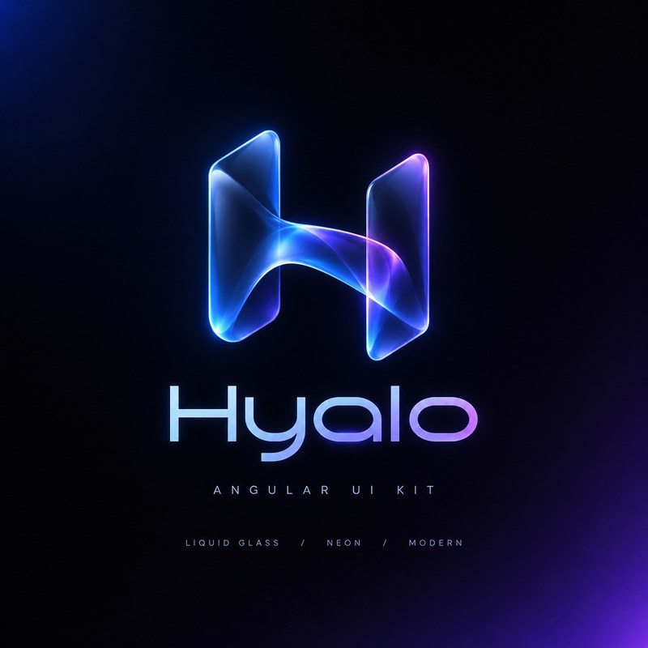

<p align="center">
  
</p>

# Hyalo

Liquid glass components for Angular.

Hyalo is a small, open source UI kit built on Angular Aria and the Angular CDK. It is signal based, zoneless, safe to render on the server, and works with a keyboard and a screen reader in both reading directions. The glass is a material you choose per surface, and it steps down by itself on devices or settings where blur would hurt.

Status: 0.1, phase 1 of the roadmap. The API can still change before 1.0.

## Install

```sh
npm install @hyalo/angular @angular/cdk @angular/aria
```

Requires Angular 22.2 or later. GSAP is optional (see [Motion](#motion)).

Add the stylesheet before your own styles in `angular.json`:

```json
"styles": ["node_modules/@hyalo/angular/styles/hyalo.css", "src/styles.css"]
```

All of it sits in cascade layers (`hy.reset`, `hy.tokens`, `hy.base`, `hy.utilities`), so any unlayered rule in your app wins without a fight.

## Usage

Every component is standalone. Import what you need:

```ts
import { HY_CARD, HyButton } from '@hyalo/angular';

@Component({
  imports: [HY_CARD, HyButton],
  template: `
    <hy-card material="clear">
      <h3 hyCardHeader>Calibre 7</h3>
      <p>Hand-wound, 42 mm.</p>
      <div hyCardFooter><button hyButton>Reserve</button></div>
    </hy-card>
  `,
})
export class Product {}
```

Form controls work with Signal Forms through `[formField]`, and with plain `[(value)]` or `[(checked)]` bindings when you do not need a form.

```html
<hy-field label="Email" hint="Only for the receipt.">
  <input hyInput type="email" [formField]="f.email" />
</hy-field>
```

## Components

| Group      | What you get                                                                         |
| ---------- | ------------------------------------------------------------------------------------ |
| Actions    | `hyButton` on `button` and `a`                                                       |
| Surfaces   | `hy-card`, `hy-navbar`, `hy-accordion`                                               |
| Navigation | `hy-tabs`, `hy-segmented`                                                            |
| Forms      | `hy-field` with `hyInput`, `hy-select`, `hy-checkbox`, `hy-radio-group`, `hy-switch` |
| Overlays   | `HyDialog`, `HyDrawer`, `hyTooltip`, `hyPopover`, `HyToaster`                        |
| Directives | `hyMaterial`, `hyReveal`, `hyTilt`, `hyMagnetic`, `hyRipple`, `hyInteractive`        |
| Icons      | `hy-icon`, with a few built in and any Lucide icon you register                      |

Run the docs site locally for live examples and the full API of each one (see [Development](#development)).

## Configuration

`provideHyalo()` sets defaults. Use it in `app.config.ts`, or in a component's `providers` to change one part of a page. Nested calls merge with the parent.

```ts
providers: [
  provideHyalo({
    material: 'frosted', // clear | frosted | tinted | solid
    size: 'md', // sm | md | lg
    tone: 'accent',
  }),
];
```

Register extra icons by name. Only what you import ends up in the bundle:

```ts
import { Search, ArrowRight } from 'lucide';

provideHyaloIcons({ search: Search, 'arrow-end': { node: ArrowRight, mirrorRtl: true } });
```

## Theming

Everything visual is a CSS custom property starting with `--hy-`: colours, surfaces, radii, spacing, type steps, durations and easing. Override them in your own stylesheet:

```css
:root {
  --hy-accent: #0b7a75;
  --hy-radius-l: 1.25rem;
}
```

Each component also reads its own tokens, such as `--hy-button-radius`, `--hy-field-bg` or `--hy-toast-width`. They are unset by default and fall back to the system tokens, so you can restyle one component, or one section of a page, without touching the rest:

```css
.admin {
  --hy-button-radius: var(--hy-radius-s);
  --hy-control-md: 2.25rem;
}
```

Every component page in the docs lists its tokens, and the Theming page has a live editor that writes the CSS for you.

Dark mode follows the system by default. Force it with `data-hy-theme="dark"` (or `light`) on `<html>`, or with the `hy-theme-dark` class on any element. High contrast, forced colours and reduced transparency each get their own fallback, and glass turns solid where `backdrop-filter` is missing.

### Palettes

Six optional palettes live in `styles/palettes/`: `aurora`, `ember`, `orchid`, `ocean`, `rose` and `graphite`. Each file covers light and dark with `light-dark()` and weighs about 450 bytes gzipped. Keep them out of the initial bundle by adding each one as a non-injected style:

```json
{
  "input": "node_modules/@hyalo/angular/styles/palettes/ocean.css",
  "bundleName": "palette-ocean",
  "inject": false
}
```

Then switch with `HyPalette`. It loads the file on first use and sets `data-hy-palette` on `<html>` only once the file is in, so nothing flashes:

```ts
const palette = inject(HyPalette);
palette.preload('ocean'); // on hover, so the switch is instant
palette.use('ocean');
palette.use(null); // back to the built-in palette
```

Serve the files from somewhere else with ``provideHyalo({ paletteHref: (name) => `/themes/${name}.css` })``.

## RTL

Every style uses logical properties, so `dir="rtl"` on the page is enough. Placements are `start` and `end` instead of left and right, drawers slide from the correct edge, arrow keys are mirrored in tabs and radio groups, and icons that point somewhere (like `chevron-end`) flip on their own. `lang="fa"` switches to a Persian friendly font stack and line height.

If you change direction at runtime, update the CDK `Directionality` as well, so overlays follow.

## Motion

Durations and easing come from tokens, and every animation respects `prefers-reduced-motion`. `HyMotion.setReduced()` lets users override it from your own settings.

Cursor effects such as tilt and magnetic use GSAP when you provide it, and plain CSS transitions when you do not. GSAP never enters your bundle unless you pass a loader:

```ts
provideHyalo({ gsap: () => import('gsap').then((m) => m.gsap) });
```

## Fidelity tiers

`HyFidelity` picks `high`, `medium` or `low` from the device (memory, CPU cores and data saver). Reduced motion leaves the tier alone: it turns off decorative motion and makes overlays cross-fade instead. Low turns glass solid, switches `hy-select` to a native select and stops pointer effects. The server and the first client render always use `medium`, so hydration matches, and the real tier applies right after. Force a tier with `provideHyalo({ fidelity: 'low' })` or `HyFidelity.setTier()`.

## Accessibility

The target is WCAG 2.2 AA. Tabs, select and accordion follow the APG patterns through Angular Aria, and overlays use the CDK focus tools for trapping and restoring focus. Every component spec runs axe. If you find a gap, please open an issue, it counts as a bug.

## Development

```sh
npm install
npm start          # docs site at http://localhost:4200
npm test           # unit tests (Vitest)
npm run lint       # ESLint, logical CSS check and prose check
npm run build      # library to dist/hyalo, then the docs site
```

The repo has two projects: `projects/hyalo` is the published library and `projects/docs` is the documentation site, which uses the library straight from source.

See [CONTRIBUTING.md](CONTRIBUTING.md) for how changes are made.

## Roadmap

Phase 2 brings the showcase pieces: carousel, lightbox, image compare, marquee, split text reveal, refraction surface, 3D hotspot, mesh background, timeline, stepper, badge, avatar and skeleton. Later phases add data display, booking and checkout controls, and advanced form inputs.

## License

MIT
