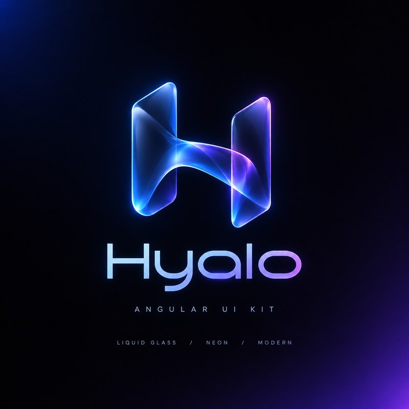

<p align="center">
  
</p>

# @hyalo/angular

Liquid glass components for Angular, built on Angular Aria and the CDK. Signal based, zoneless, server-render safe, accessible, and ready for RTL.

```sh
npm install @hyalo/angular @angular/cdk @angular/aria
```

Add the stylesheet before your own styles in `angular.json`:

```json
"styles": ["node_modules/@hyalo/angular/styles/hyalo.css", "src/styles.css"]
```

`hyalo.css` includes every overlay's styles. To leave out the ones you don't use, list `hyalo-core.css` plus the files you need from `styles/overlays/` (`select.css`, `popover.css`, `dialog.css`, `toast.css`) instead.

Then import the standalone components you need. Each one has its own entry point, so a lazy route only loads what it uses:

```ts
import { HyButton } from '@hyalo/angular/button';
import { HY_CARD } from '@hyalo/angular/card';
```

`@hyalo/angular` itself holds the shared foundations, such as `provideHyalo()`, `HyFidelity` and `HyMotion`.

Version 0.2 adds carousel, gallery and lightbox, image comparison, marquee, split text,
refraction, scene hotspots, mesh backgrounds, timeline, stepper, badges, avatars and
skeletons. Each has its own package entry point, such as `@hyalo/angular/carousel`.
Button groups, links, dividers, aspect-ratio frames, chapter navigation and scroll-to-top
controls are included too. The existing segmented control provides toggle groups.

Refraction uses a supplied same-origin or CORS-enabled image and one shared WebGL
context on high fidelity. CSS glass remains available on other tiers or when WebGL
cannot run. The gallery uses the existing dialog overlay styles.

Configuration, theming, RTL, motion and the full component list are in the [repository README](https://github.com/HamedRsl/Hyalo#readme).

MIT licensed.
